# APP_FLOW.md — Surakshit Basti Application Flow

Tags: `[PROJECT REQUIREMENT]` · `[CURRENT ENVIRONMENT FACT]` · `[ENGINEERING DECISION]` · `[OPTIONAL FUTURE ENHANCEMENT]`

Companion to `AGENTS.md` (rules) and `PRD.md` (requirements). Formulas given as project requirements are normative; anything else is marked as an engineering decision. The PRD wins on any conflict.

---

## 1. User journey

Primary user `[PROJECT REQUIREMENT]`: SDMA official; also District Collector/DDMA, NDRF/SDRF planners, block officials, planners.

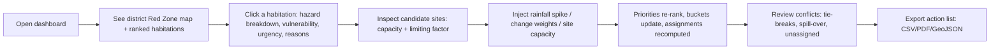

This is the **six-scene demo** defined in the PRD: Baseline → Explain → Sites → Trigger → Conflict → Output. `[PROJECT REQUIREMENT]`

## 2. Application startup

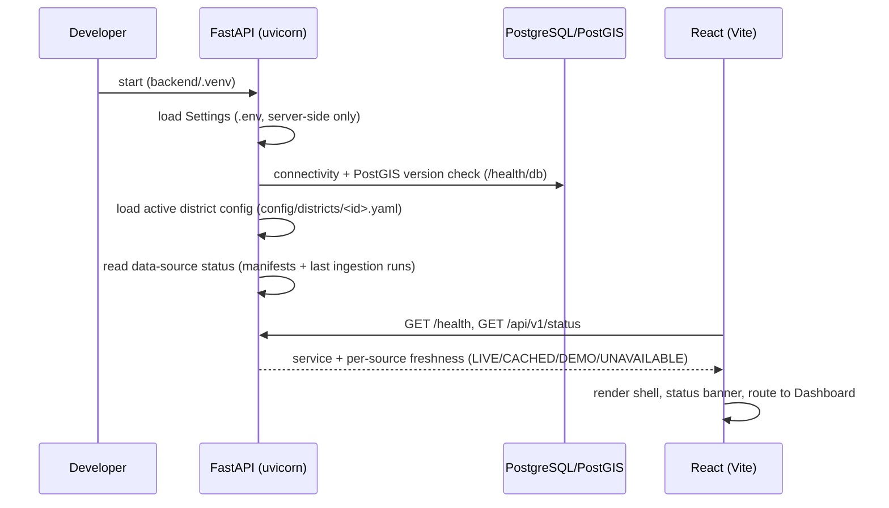

- `[CURRENT ENVIRONMENT FACT]` `/health` and `/health/db` already work and are preserved unchanged.
- `[ENGINEERING DECISION]` Startup never calls external services. Missing data makes features report `UNAVAILABLE`, not crash startup.
- Pilot district is selected by config (`ACTIVE_DISTRICT` setting). `[PROJECT REQUIREMENT]` (district = configuration) / **pilot pending**.

## 3. Dashboard

Layout `[ENGINEERING DECISION]` (content from the PRD MVP scope): left **layer panel**, centre **map**, right **detail/explanation panel**, bottom or tabbed **priority table** and **site fill bars**, top **status bar** (district, scenario, data freshness badges, threshold sliders, rainfall-spike control, export).

Routes (React Router): `/` dashboard, `/habitations/:id` deep link, `/sites/:id`, `/scenarios`, `/validation` (backtest & sensitivity), `/data-status`, `/about` (assumptions, licences, limitations).

## 4. GIS map

- MapLibre GL JS; layers fetched as GeoJSON from API; styling by class (Red/Amber/Green) using high-contrast palette. `[PROJECT REQUIREMENT]` (high-contrast for projectors)
- Layers: hazard cells (composite, per-hazard toggles), structural vs dynamic zones, habitations (colour by bucket, size by population), candidate sites (tier icon, fill bar), roads (if available), district boundary.
- Click → detail panel; hover → tooltip with score and status badge.
- Turf.js is used only for light client-side tasks (bbox, centroid, distance for UI hints).
- Large layers: bbox-filtered requests; simplification at low zoom. `[ENGINEERING DECISION]`

## 5. Hazard layers

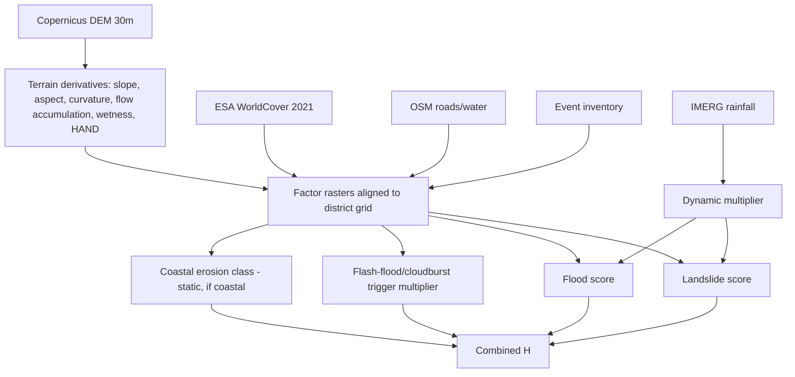

`[PROJECT REQUIREMENT]` factors per hazard: Landslide — slope, aspect, curvature, geology/soil, distance to drainage, distance to roads, LULC/NDVI, rainfall, past landslide points. Flood — HAND, distance to river, flow accumulation, wetness index, rainfall, flood history, LULC. Cloudburst — catchment steepness + extreme rainfall (trigger multiplier). Coastal — shoreline-change rate, distance to shoreline, coastal slope, protection.

`[ENGINEERING DECISION]` Factors with no available pilot data (e.g. geology/soil) are omitted and listed in `docs/assumptions.md`; weights are renormalised and the omission is shown in the explanation panel.

## 6. Red Zone generation

`[PROJECT REQUIREMENT]`

- Per-cell combined hazard: `H = 1 − (1 − H_landslide)(1 − H_flood)(1 − H_coast)(1 − H_flash)` (assumes rough independence; state this openly).
- Classes (thresholds adjustable): **Red** H ≥ 0.7; **Amber** 0.4 ≤ H < 0.7; **Green** H < 0.4.
- **Structural** score (terrain + history; permanent unsuitability) and **dynamic** multiplier (current/forecast rainfall). Display both: structural Red Zones persist; temporary **Alert Zones** expand with rain.
- Grid: regular grid, 30 m rasters aggregated to 100–250 m cells (config), or micro-watersheds. `[PROJECT REQUIREMENT]`
- Initial method: weighted overlay (AHP/equal weights); ML (RF/XGBoost + SHAP) added next; per-factor contributions shown on click.

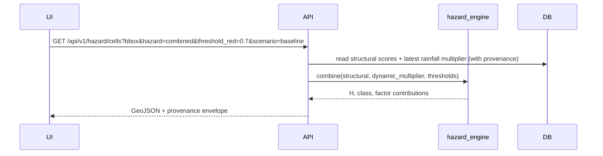

## 7. Habitation selection

- Habitations are points/polygons that inherit hazard from overlapping cells (area-weighted or max — `[ENGINEERING DECISION]`: use **max** cell hazard under the footprint as the conservative default, configurable).
- Click on a habitation (map or table) → `GET /api/v1/habitations/{id}` returns profile, hazard breakdown, vulnerability components, urgency terms, bucket, assignment, reasons, provenance (`DEMO_SYNTHETIC` demographics clearly badged).
- Population/households: census-based or synthetic proxies, labelled. `[PROJECT REQUIREMENT]`

## 8. Risk / urgency calculation

`[PROJECT REQUIREMENT]`

```
U_i = H_i × (0.5 + V_i) × T_i × log(1 + P_i)   → normalised to 0–1
```

H hazard score; V vulnerability index (0–1); T time-to-impact factor (1.0 baseline, rising toward ≈1.5 as a forecast trigger nears or a recent slope failure/flood is recorded); P population. The log term damps very large settlements.

`[ENGINEERING DECISION]` Normalisation: min–max across the active district's habitations within the scenario (documented), unless the user later specifies otherwise. T mapping: linear between 1.0 and 1.5 from rainfall-trigger ratio / recent-event recency; exact mapping lives in config and is shown in the UI.

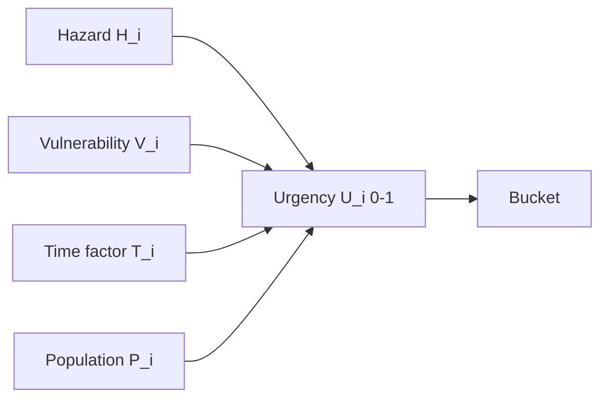

## 9. Vulnerability factors

`[PROJECT REQUIREMENT]` 0–1 index from: share of children under 6, share aged 60+, share of persons with disabilities, share of female-headed households, share of kutcha houses, distance to nearest health facility. Combined with **adjustable weights** (start equal, or AHP). Components displayed separately.

Rule `[PROJECT REQUIREMENT]`: vulnerability raises protection priority; it never removes anyone from consideration.

Data: Census 2011 (village directory, PCA), WorldPop, Google/Microsoft buildings as options; otherwise synthetic, **labelled `DEMO_SYNTHETIC`**. Health-facility distance may come from OSM (if available) else marked unavailable/proxy.

## 10. Relocation-site discovery

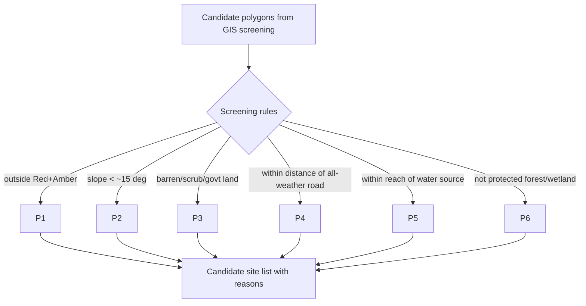

`[PROJECT REQUIREMENT]` rules, thresholds adjustable; MVP expects **3–8 sites** in the pilot, each with selection reasons; two tiers: **temporary shelters** and **permanent sites**. Sites are screened, not surveyed — labelled so. Cadastral/PM Gati Shakti data is `[OPTIONAL FUTURE ENHANCEMENT]` for real deployment.

`[ENGINEERING DECISION]` Where official site/land data are unavailable, candidate generation = raster screening → polygonise → size filter; WorldCover classes map to the "barren/scrub/government land" test (government-land ownership cannot be inferred; recorded as an assumption).

## 11. Capacity calculation

`[PROJECT REQUIREMENT]` `C_j = min(C_land, C_water, C_sanitation, C_road, C_services)`; the argmin is the **limiting factor** and is displayed.

| Component | Formula |
|---|---|
| C_land | usable area ÷ land per household (incl. share for roads/common areas) |
| C_water | sustainable supply ÷ per-person daily need |
| C_sanitation | toilets/treatment capacity ÷ norm per person |
| C_road | access capacity from road width + connectivity |
| C_services | schools/health facilities within reach |

Norms are **configurable assumptions** (Sphere-style for temporary shelters, state housing norms for permanent sites) stored in `config/capacity_norms.yaml` with source notes; **no numeric norm is invented here** — the agent must research/cite or ask the user, and mark unsourced values as placeholders. `[ENGINEERING DECISION]` Units must be harmonised (people vs households) via an explicit household-size parameter.

Water/sanitation supply inputs usually have no open data → `DEMO_SYNTHETIC`, labelled. Uncertainty: show low/medium/high confidence per site. `[PROJECT REQUIREMENT]`

## 12. Route / accessibility analysis

`[ENGINEERING DECISION]` (the PRD requires distance/time `d_ij` and road access; a dedicated "route engine" is an implementation choice). Build a road graph from OSM (live→cache→extract), run NetworkX shortest paths (time or distance weighted) from habitation access nodes to site access nodes, produce a precomputed `d_ij` matrix + eligibility (within distance limit). If OSM is unavailable → fall back to **straight-line distance** from PostGIS, **labelled "straight-line fallback"**, and routing-dependent features show reduced confidence. Also derive "distance to nearest all-weather road" for screening and `C_road`.

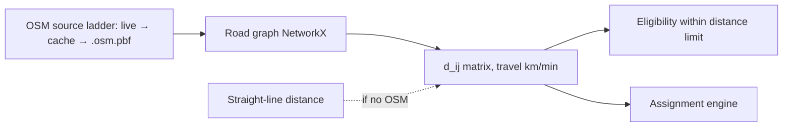

## 13. Assignment

`[PROJECT REQUIREMENT]`

**Greedy:** sort by urgency (ties: higher vulnerability, then larger population, then closer site) → for each, find eligible sites (correct tier, within distance limit, remaining capacity ≥ population/households) → assign nearest eligible → reduce capacity → if none: consider splitting by household groups, or mark **unassigned with a reason**.

**Optimal (ILP):** x_ij ∈ {0,1}; maximise Σ_ij (U_i·P_i − λ·d_ij·P_i)·x_ij; subject to each habitation → at most one site; Σ_i P_i·x_ij ≤ C_j; x_ij = 0 for ineligible pairs. Optional fractional household-group splitting if keeping communities together is relaxed. Solve with OR-Tools (pinned); report improvement/optimality gap vs greedy. `λ` is configurable (`[ENGINEERING DECISION]`: default chosen with the user after seeing sensitivity runs; do not pick silently).

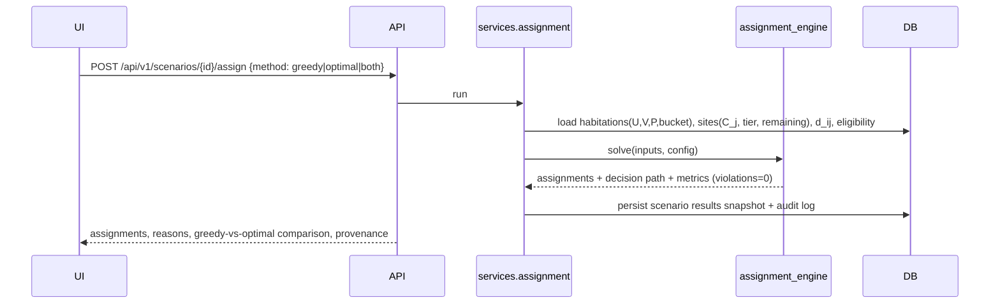

Prefer keeping a habitation together and near livelihood/administrative area `[PROJECT REQUIREMENT]` (MVP treatment: community kept whole by default — splitting is an explicit option).

## 14. Three time buckets

`[PROJECT REQUIREMENT]` (thresholds configurable)

| Bucket | Rule | Destination tier |
|---|---|---|
| Immediate | U ≥ 0.75, **or** H ≥ 0.85 with an active alert | Temporary safe shelters outside all Red/Amber zones |
| Short-term | 0.45 ≤ U < 0.75 | Permanent or transit sites, planned over months |
| Medium-term | U < 0.45 but inside a structural Red Zone | Permanent sites, scheduled with budget cycle |

`[ENGINEERING DECISION]` Habitations with U < 0.45 and outside a structural Red Zone get bucket `NONE` (monitor) — the requirements are silent here; documented assumption. "Active alert" = scenario rainfall trigger exceeds threshold, from live/cached IMERG or the simulator.

## 15. Explanation / reasoning

`[PROJECT REQUIREMENT]` Every assignment has a reason; top three reasons and timestamp (Should). Store the **decision path**: rank, candidate sites considered, why each was chosen/rejected (capacity, distance, tier). Reason template example: *"Assigned to Site B because Site A was full after higher-urgency Village 7; Site B is 4.2 km away with water as limiting factor."* Reasons are **generated by deterministic templates from computed values**. SHAP/factor contributions feed hazard reasons. An LLM may paraphrase later (`[OPTIONAL FUTURE ENHANCEMENT]`) but never change numbers.

## 16. Alerts / notifications

- `[OPTIONAL / Could]` CAP-style alert **drafts** for the Immediate bucket (sample in two languages). Draft only; no sending. `[PROJECT REQUIREMENT]` (Could)
- In-app alert banner when a scenario/live rainfall trigger pushes habitations into Immediate.
- SACHET/SMS/WhatsApp integration is `[OPTIONAL FUTURE ENHANCEMENT]` (roadmap).

## 17. Data freshness

Each data feed exposes `retrieved_at`, `valid_time`, `age_seconds`, `freshness` (`FRESH|STALE|UNKNOWN`). `[ENGINEERING DECISION]` Staleness thresholds in config (e.g. IMERG NRT stale after a configured number of hours; terrain/landcover are static, so freshness = "static reference, vintage X"). The status bar and `/data-status` page list: IMERG, DEM, WorldCover, OSM, event inventory, demographics, sites — each with origin badge, vintage, licence.

## 18. LIVE / CACHED / DEMO states

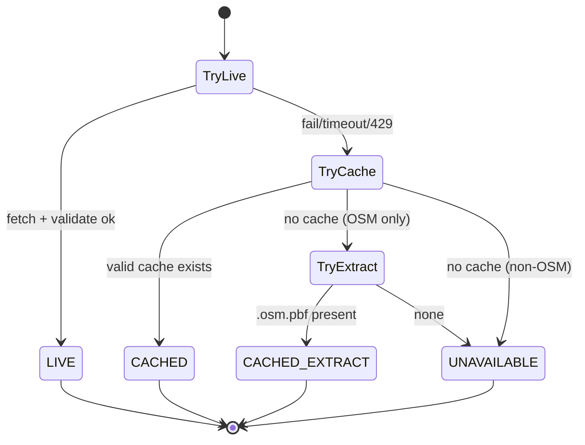

`DEMO_SYNTHETIC` is a separate **origin dimension** (not a fallback): used for demographics/site-supply attributes where official data aren't public, always labelled. `SIMULATED` (rainfall what-if) is a scenario label, never presented as live. `[ENGINEERING DECISION]`

## 19. External-data failure behaviour

| Failure | Behaviour |
|---|---|
| IMERG PPS down/auth fails | Serve latest cached rainfall (`CACHED`, age shown); if none: dynamic layer `UNAVAILABLE`, structural zones remain, simulator still works. **Do not alter PPS credentials/auth.** |
| Overpass timeout/rate-limit | Use cached OSM → regional extract → straight-line fallback; banner explains |
| S3 (DEM/WorldCover) unreachable | Use already-downloaded raw/processed files (they're static); only first-time ingestion fails, with clear CLI error |
| DB down | `/health/db` reports failure; API returns 503 on data routes; frontend shows offline state |
| Solver failure/timeout | Return greedy result with notice |
| Partial data (some factors missing) | Compute with available factors, renormalise weights, list missing factors in explanation and lower confidence |

Frontend: never shows a blank map; shows banner + last good data with its status.

## 20. Backend API flow (proposed `/api/v1`) `[ENGINEERING DECISION]`

```
GET  /health, /health/db                          (existing, unchanged)
GET  /api/v1/status                               data-source freshness + active district
GET  /api/v1/districts/active
GET  /api/v1/hazard/cells?bbox&hazard&scenario    GeoJSON + provenance
GET  /api/v1/hazard/summary                       class areas, thresholds in use
GET  /api/v1/habitations?bucket&min_urgency       list + GeoJSON option
GET  /api/v1/habitations/{id}                     profile + breakdown + reasons
GET  /api/v1/sites, /api/v1/sites/{id}            capacity per resource, limiting factor, remaining
GET  /api/v1/assignments?scenario                 assignments + reasons
POST /api/v1/scenarios                            create (rainfall multiplier, weights, site adjustments)
POST /api/v1/scenarios/{id}/run                   recompute hazard→urgency→assignment
GET  /api/v1/scenarios/{id}/compare               baseline vs scenario; greedy vs optimal; distance-only vs vulnerability-weighted
GET  /api/v1/validation/backtest, /sensitivity
GET  /api/v1/export/actions?format=csv|pdf|geojson
GET  /api/v1/audit
```

## 21. Database flow

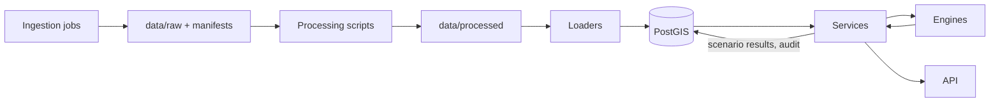

Entities `[PROJECT REQUIREMENT]`: **Cell, Habitation, Site, Event, Scenario, Audit log**. `[ENGINEERING DECISION]` supporting tables: `districts`, `datasets` (manifest mirror), `ingestion_runs`, `rainfall_observations`, `assignments`, `scenario_results`, `capacity_norms`. All through migrations; all spatial columns SRID 4326 + GiST.

## 22. ML flow

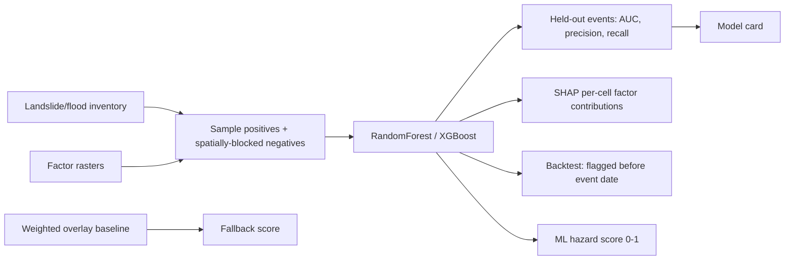

Baseline weighted overlay is always available; ML replaces it only if validation justifies (document). Targets `[PROJECT REQUIREMENT]`: AUC ≥ ~0.75–0.85 depending on data quality; one backtested event flagged before the event.

## 23. Optimisation flow

1. Build inputs: habitations (U, V, P, bucket, tier needed), sites (C_j, tier, remaining), `d_ij`, eligibility.
2. Run **greedy** → assignments + decision path.
3. Run **ILP (OR-Tools)** with time limit → assignments + objective + gap.
4. Compare: protected-urgency score, total distance, unassigned counts. Show improvement.
5. Verify invariants (no capacity violation; every habitation assigned or has a reason). Failing invariants → reject result, fall back, log.
6. Persist snapshot with scenario id; write audit entry.

Rainfall-spike what-if (`[PROJECT REQUIREMENT]` re-rank in < 5 s): scenario applies a rainfall multiplier to the dynamic term only, re-evaluates hazard for affected cells/habitations, recomputes U and buckets, then runs assignment on the (small) habitation set. Structural layers and `d_ij` are precomputed so this is fast.

---

## Appendix: end-to-end sequence (rainfall spike demo)

```mermaid
sequenceDiagram
  participant U as Officer
  participant FE as React/MapLibre
  participant API as FastAPI
  participant SV as services
  participant HE as hazard_engine
  participant UE as urgency_engine
  participant AE as assignment_engine
  participant DB as PostGIS
  U->>FE: set rainfall multiplier (e.g. x2), click Run
  FE->>API: POST /scenarios (multiplier, weights) ; POST /scenarios/{id}/run
  API->>SV: run_scenario
  SV->>DB: load structural scores, habitations, sites, d_ij
  SV->>HE: apply dynamic multiplier → H, classes
  SV->>UE: V, T, P → U, buckets
  SV->>AE: assign (greedy+optimal)
  AE-->>SV: assignments + reasons
  SV->>DB: persist snapshot + audit
  API-->>FE: updated zones, ranks, buckets, assignments, provenance (rainfall = SIMULATED)
  FE-->>U: map + table re-rank (< 5 s), two villages move into Immediate (demo)
```